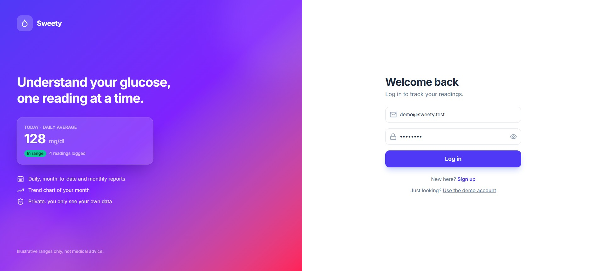
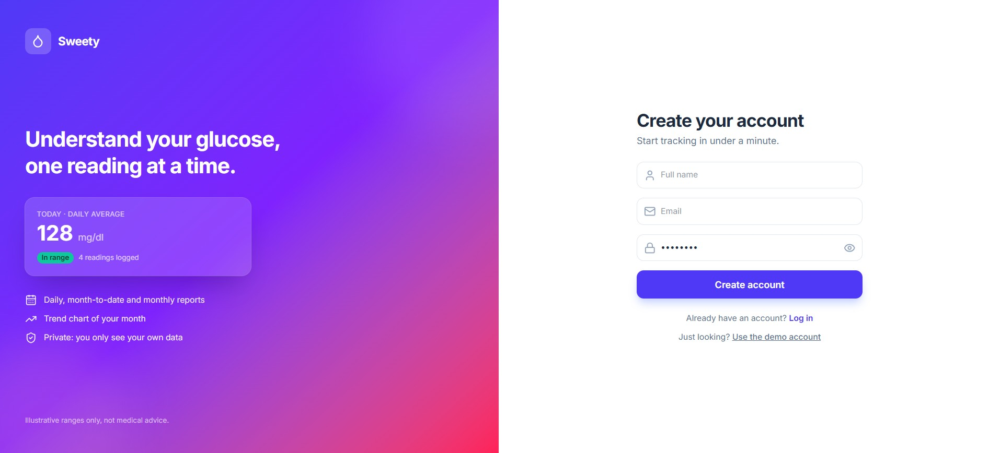
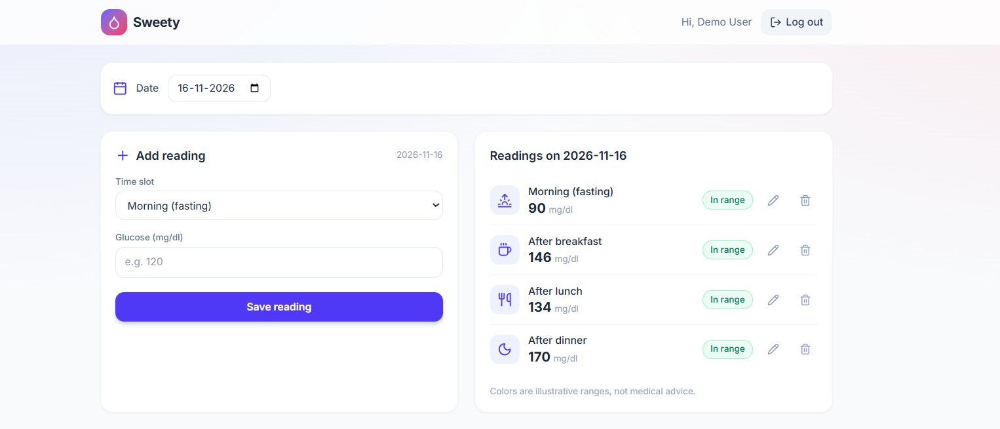
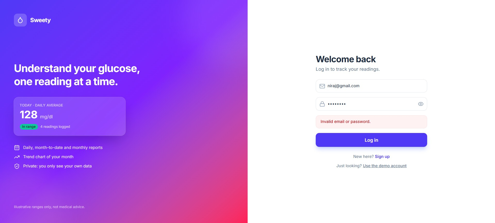
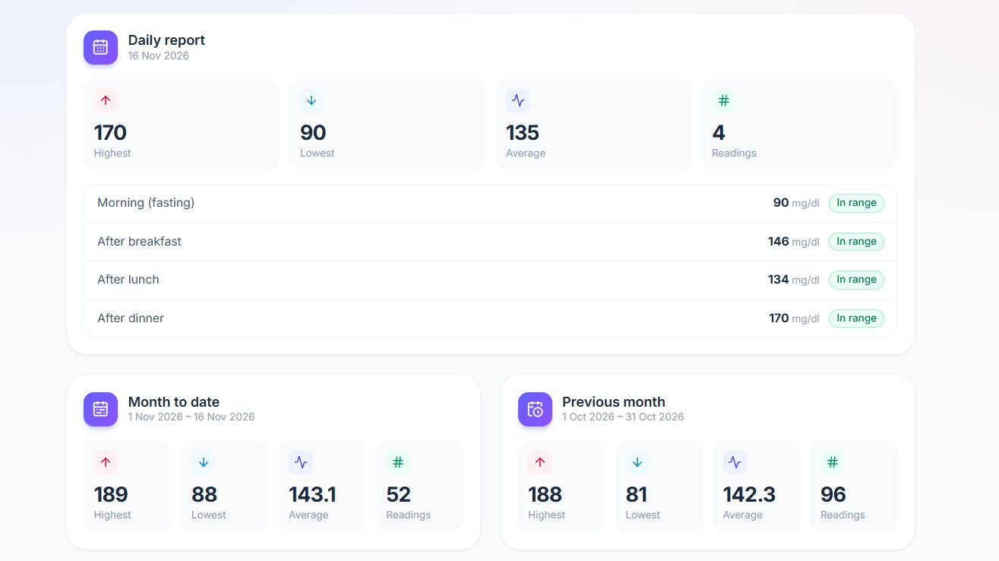
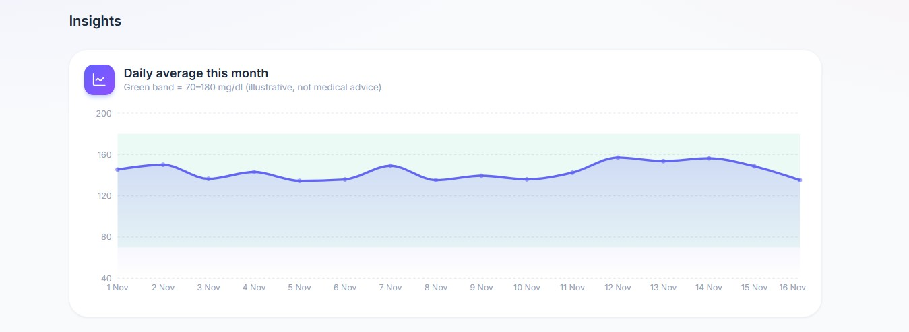
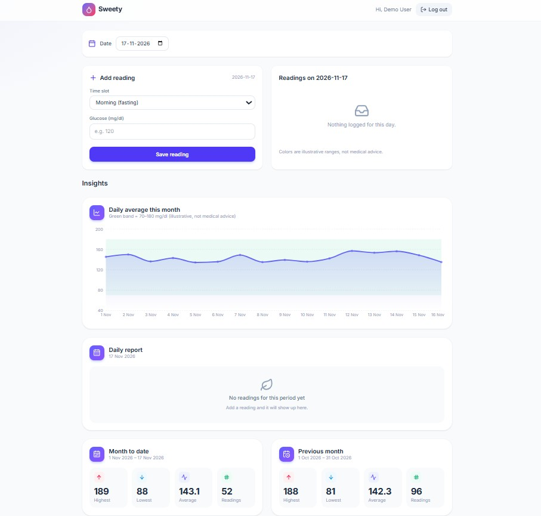
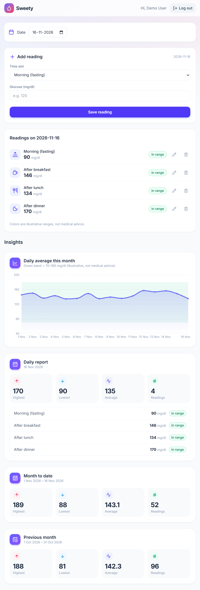

# Sweety – Blood Glucose Tracker

A web app where a diabetes patient records up to 4 blood glucose readings a day and views daily, month-to-date and monthly reports.

**Stack:** Node.js, Express, PostgreSQL (`pg`), React (Vite), Tailwind CSS, Recharts, JWT + bcrypt, Jest + Supertest, Vitest + React Testing Library, Docker Compose (PostgreSQL, API and client).

## Screenshots

| Login | Sign up |
|---|---|
|  |  |

**Dashboard: add a reading and view the day's readings**


**Validation error shown in the UI**


**Monthly trend chart**


**Daily, month-to-date and previous-month reports**


**Friendly empty state (no readings for the day)**


**Full page (mobile width)**


## Features
- Sign up / log in (bcrypt-hashed passwords, JWT); users only see their own readings
- Add, view, edit, delete readings (4 slots per day)
- Validation with clear error messages shown in the UI
- Daily, month-to-date and previous-month reports (highest, lowest, average, count, friendly empty state)
- Monthly trend chart (Recharts) with a shaded 70–180 mg/dl band
- Color-coded readings (illustrative ranges, not medical advice)
- Pagination (`page`, `limit`) and date filtering (`date`, or `from` + `to`) on `GET /api/readings`
- Backend tests (Jest + Supertest) and frontend tests (Vitest + React Testing Library)
- Docker Compose runs PostgreSQL, the API and the client together

## Prerequisites
Node.js 18+ (20 LTS recommended), npm, and either Docker Desktop or a local PostgreSQL 14+.

## Setup

```bash
git clone https://github.com/NIRU0802/Sweety-Blood-Glucose-Tracker.git
cd Sweety-Blood-Glucose-Tracker
```

### Quick start with Docker (everything in containers)
```bash
docker compose up --build -d
docker compose exec server npm run seed
```
Open http://localhost:8080 and log in with the demo account below. Stop with `docker compose down` (data is kept in a Docker volume).

Optional: set your own secret with `JWT_SECRET=your_long_random_string docker compose up --build -d`.

The steps below run things locally instead, which is better for development and for running the tests.

### 1. Database
Docker (database only):
```bash
docker compose up -d db
docker compose exec db createdb -U postgres sweety_test
```
Local PostgreSQL: create databases `sweety` and `sweety_test`, then put your credentials in `server/.env`.

### 2. Server
```bash
cd server
cp .env.example .env      # Windows PowerShell: Copy-Item .env.example .env
npm install
npm run migrate           # creates tables
npm run seed              # demo user + sample readings
npm run dev               # http://localhost:5000
```
Set `JWT_SECRET` in `.env` to a long random string.

### 3. Client
```bash
cd client
npm install
npm run dev               # http://localhost:5173
```
The Vite dev server proxies `/api` to `http://localhost:5000`, so start the server first.

### 4. Tests

Backend (Jest sets `NODE_ENV=test`, so it uses `TEST_DATABASE_URL` and truncates that database's tables):
```bash
cd server
npm test
```

Frontend (reading form tests, no database needed):
```bash
cd client
npm test
```

## Demo login
`demo@sweety.test` / `Demo@123`

## Environment variables (`server/.env.example`)
| Variable | Purpose |
|---|---|
| PORT | API port (5000) |
| DATABASE_URL | Main database |
| TEST_DATABASE_URL | Database used by tests |
| JWT_SECRET | Secret for signing tokens |
| JWT_EXPIRES_IN | Token lifetime (7d) |
| APP_TIMEZONE | Timezone for the "future date" check (Asia/Kolkata) |

In Docker, these are set in `docker-compose.yml` instead (the database host is `db`, not `localhost`).

## API
| Method | Route | Purpose |
|---|---|---|
| POST | /api/auth/register | Sign up |
| POST | /api/auth/login | Log in, returns JWT |
| GET | /api/readings | List own readings (`date`, `from`+`to`, `page`, `limit`) |
| POST | /api/readings | Add reading |
| PUT | /api/readings/:id | Edit reading |
| DELETE | /api/readings/:id | Delete reading |
| GET | /api/reports/daily?date= | Daily report |
| GET | /api/reports/month-to-date?date= | Month-to-date report |
| GET | /api/reports/monthly?date= | Previous month report |

All routes except register and login need `Authorization: Bearer <token>`. Errors use the format `{ "error": "message" }`.

## Notes

### Assumptions
- Dates are plain `YYYY-MM-DD` strings. The client sends the user's local date and the server checks "future" using `APP_TIMEZONE` (default Asia/Kolkata).
- With 4 slots and one reading per slot per day, the "max 4 per day" rule can never trigger before the duplicate-slot rule. Both are implemented, and the database has `UNIQUE (user_id, reading_date, slot)` as a safety net.
- "Monthly" means the whole previous month relative to the selected date (January goes to December of the previous year).
- Average is rounded to 1 decimal; empty periods return nulls and the UI shows an empty state.
- The value status colors (Low under 70, In range 70–180, High up to 250, Very high above) and the chart band are illustrative only, not medical advice.
- The preview card on the login page is static and illustrative, not real data.
- JWT is stored in `localStorage` for simplicity. Password minimum is 6 characters.
- The Docker setup uses a demo default for `JWT_SECRET` and the default Postgres password; both must be changed for any real deployment.
- Vitest is pinned to v2 because the project uses Vite 5.
- `npm audit` warnings come from dev dependencies and old transitive packages; I did not force-upgrade them.

### What I'd improve with more time
- HttpOnly cookies, refresh tokens, login rate limiting, `helmet`
- More edge-case API tests and frontend tests for the dashboard and auth page
- A pagination UI (for example a "recent readings" history list)
- A CI pipeline (GitHub Actions) running both test suites
- Deployment (Render + Neon + Vercel)
- Doctor role, Redis caching, BullMQ reminders